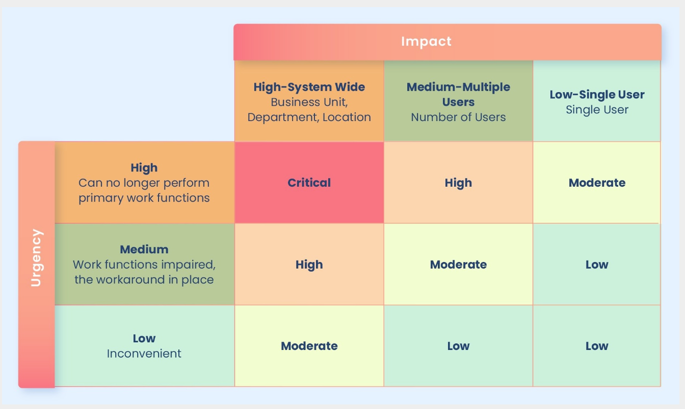
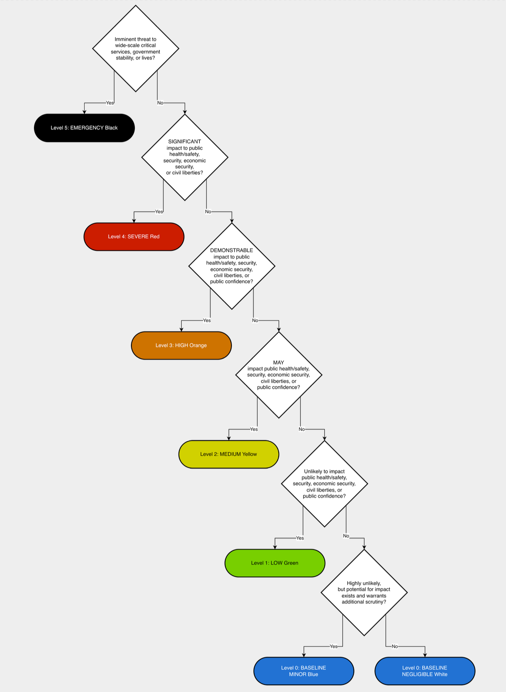

- The Incident Response Preparation Paradox (IRPP): *Incident Response preparation's value is most apparent when it's needed least*.
- The IRPP can create tension in resource allocation decisions. Security teams can address this tension by framing preparation investments in terms of risk reduction rather than incident prevention.Tracking metrics that demonstrate the value of preparation provides tangible evidence: _reduced mean time to detect_ (**MTTD**), faster containment during training exercises, and improved coordination during tabletop scenarios. These measurements provide evidence of preparation effectiveness without requiring an actual incident to demonstrate value to the organization.

# Preparation Strategies

- Preparation activities are grouped into three main areas:
  - **Preparing the organization**: _Developing the policies, plans, and playbooks that govern decision-making, establishing management support, and defining how the organization communicates and coordinates during an incident_.
  - **Preparing the incident response team**: _Building the technical skills, playbooks, relationships, and tooling that enable responders to act decisively when incidents occur._
  - **Proactive prevention and detection**: _Deploying monitoring, threat intelligence, and hardening measures that reduce incident frequency and improve the team's ability to identify threats early._

- **Policies**: _High-level directives set by organizational leadership, often the CISO or executive team. They establish the boundaries for decision-making: whether to pay ransom, when to involve the legal counsel, and under what conditions to disclose publicly. Policies answer the question "what has the organization decided?"_
- **Plans**: _The incident response plan translates policy into operational structure. It defines roles and responsibilities (often through a RACI matrix), delegated authority, escalation paths, and communication workflows. The plan answers the question "how do we respond"?_
- **Playbooks**: _These provide step-by-step guidance for responding to specific incident types and using specific tools. A ransomware playbook, for example, walks responders through containment, evidence collection, and recovery actions tailored to that scenario. Playbooks answer the question "how do we respond?"_

## Prepare the Organization

### Develop Organizational Policies

- Among the incident response policy elements, **containment authorization** deserves particular attention. During incidents, responders frequently hesitate over questions like "Am I allowed to shut down this server?" or "Can I isolate this network segment?" This hesitation, sometimes called **escalation paralysis**, delays containment while responders seek approval through ad hoc channels. Documenting authorization levels in advance reduces this delay by establishing clear decision rights for common containment actions.

- FRSecure Incident Response Plan Template
- ICIMS Incident Response Policy Template
- GovRAMP Incident Response Plan Template
- Prima Incident Response Plan Template
- CIS Incident Response Policy Template
- CRF Resilience Management Policy Template

### Develop Management Support

### Identify Risk Assessment and Classification Processes

#### CISA Incident Scoring

### Develop an Incident Communications Plan

- Applying C4 thinking to incident communications means evaluating every message, update, and notification against four characteristics:
  - **Coherent**
  - **Consistent**
  - **Concise**
  - **Converted**
- These four characteristics apply across every component of the incident communication plan. When reviewing or exercising the plan, evaluate each component against them.

#### Establish Communication Channels

- When establishing communication channels, consider the platform characteristics that are important for incident response, including confidentiality, authentication, mobility, rich information sharing, and more. A summary of the important factors to consider when selecting a communication platform is:
  - **Authentication**: _Identity validation for participants through strong authentication including MFA._
  - **Confidentiality**: _Encryption of messages, access-controlled channels, and access controls to prevent unauthorized access to conversations._
  - **Mobility**: _Accessible from desktops and mobile devices with consistent security across platforms. Notification controls for mobile devices._
  - **Data Retention**: _Conversation history preservation for documentation, stakeholder awareness, and potential legal or regulatory inquiries._
  - **Resilience and Availability**: _High availability with protections against outages and denial of service attacks during incidents._
  - **Access Logging**: _Recording of participant identities and platform access for audit and accountability purposes._
  - **Communication Clarity**: _Threaded messaging and channel organization to keep discussions focused when multiple investigations are active._
  - **Data Provenance**: _Ability to identify who posted information, when it was posted, and whether it has been edited._
  - **Rich Information Sharing**: _Support for files, images, code snippets, and collaboration features including text, voice, video, and screen sharing._

#### Establish External Reporting Channels

- The RFC 9116 standard defines a machine-readable file that organizations place on their web servers to communicate security contact information and vulnerability disclosure policies. Organizations publish a **security.txt** file at **/.well-known/security.txt** on their web servers. The file contains contact information (email, phone, or URL), an expiration date, and optional fields for encryption keys, disclosure policies, acknowledgement pages, and preferred languages.

#### Develop an Emergency Communication Plan

